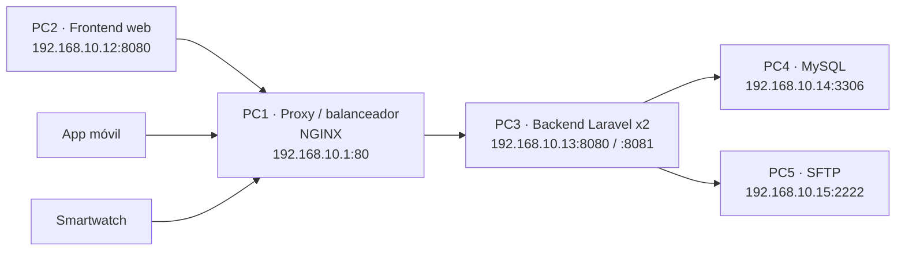

# Arquitectura de red — MedTriaje

Topología **física** del clúster del proyecto sobre la red `192.168.10.0/24`, con los
nodos conectados a un **switch de 8 puertos**. Cada componente se ejecuta en un nodo
dedicado; el backend corre como dos instancias balanceadas y no se utiliza orquestación
de contenedores en este despliegue.

## Tabla de nodos

| Nodo | Equipo / SO | Rol | Tecnología | IP | Puerto(s) | Protocolo | Encargado |
| :--- | :--- | :--- | :--- | :--- | :--- | :--- | :--- |
| **PC1** | Laptop · Linux (CachyOS) | Proxy inverso y balanceador de carga | NGINX | `192.168.10.1` | `80` | HTTP | Gonzalo |
| **PC2** | Laptop · Windows | Frontend web | Apache (XAMPP) | `192.168.10.12` | `8080` | HTTP | Ginger |
| **PC3** | VM · Ubuntu Server | Backend / API (2 instancias) | Laravel · PHP 8.4 | `192.168.10.13` | `8080`, `8081` (SSH `22`) | HTTP / SSH | Bryan |
| **PC4** | VM · Ubuntu Server | Base de datos | MySQL 8.4 | `192.168.10.14` | `3306` | TCP | Carlos |
| **PC5** | VM · Ubuntu Server | Servidor de archivos | SFTP (OpenSSH) | `192.168.10.15` | `2222` | SFTP / TCP | Gonzalo |

## Diagrama de topología

## Flujo de una petición

1. El cliente (frontend en PC2, o la app móvil/smartwatch) solicita `http://192.168.10.1`.
2. PC1 (proxy/balanceador) recibe la petición en el puerto `80` y la balancea entre las dos instancias del backend en PC3 (`:8080` y `:8081`).
3. PC3 (Laravel) procesa la lógica de negocio y consulta la base de datos en PC4 (`192.168.10.14:3306`).
4. Si la petición sube o descarga un PDF, PC3 usa el servidor de archivos PC5 (`192.168.10.15:2222`) por SFTP.
5. PC3 devuelve la respuesta en JSON a PC1, y PC1 la entrega al cliente.
6. Si una instancia de PC3 deja de responder, el balanceador redirige el tráfico a la otra (failover).

## Notas

- **Red:** todo el clúster opera en `192.168.10.0/24`. Los 5 nodos se interconectan a
  través de un **switch**.
  Las direcciones `192.168.0.x` que aparecen en las capturas corresponden a una interfaz
  secundaria (modo puente) y no se utilizan en el proyecto.
- **Proxy (PC1):** NGINX (`proxy/nginx.conf.template`). HAProxy es la alternativa si el docente exige sondeo activo de salud (no implementado).
- **Consistencia:** los puertos y direcciones coinciden con lo declarado en `.env.example`
  (`BACKEND1`/`BACKEND2` → `192.168.10.13:8080` y `:8081`, `TRUSTED_PROXIES` → `192.168.10.1`,
  `DB_PORT` → `3306`, `CORS_ALLOWED_ORIGINS` → `http://192.168.10.12`).
- **Degradación:** si PC5 cae, `/health` responde 503 pero el resto de la API sigue operativa. PC1 genera o reutiliza `X-Request-ID` y lo propaga al backend para los logs.
- **Integración externa:** el sistema de laboratorio clínico existente se integra por API y
  queda fuera de esta topología; su endpoint se marcará como **"Por definir"** una vez
  acordado con el laboratorio. El resto de parámetros de los 5 nodos están definidos.
